# hadistory — enclosure for the Pico version

A 3D printed case, portrait, with the Inky Impression 5.7" as the face and the electronics in the back shell: back shell, bezel, a cap over the HAT wiring, four push keys, a story dial thumbwheel and two label plates. Design inspired by the [YouMakeTech Pico-GB](https://www.youmaketech.com/pico-gb-gameboy-emulator-handheld-for-raspberry-pi-pico/) bottom cover: every part sits in a moulded pocket or on standoffs, and all the wiring is Dupont jumpers.

Two styles in the same model, `style` at the top of the file. **`bump`** (v10, the default): 26 mm body, 10 mm corners, chamfered back edge, rounded bezel edge, and a pillow-shaped cap on the back over the HAT Dupont block, the only place that needs the depth. **`box`** (v7): the rectangular shell, 33 mm deep everywhere, validated by the test prints. The insides are the same.

| 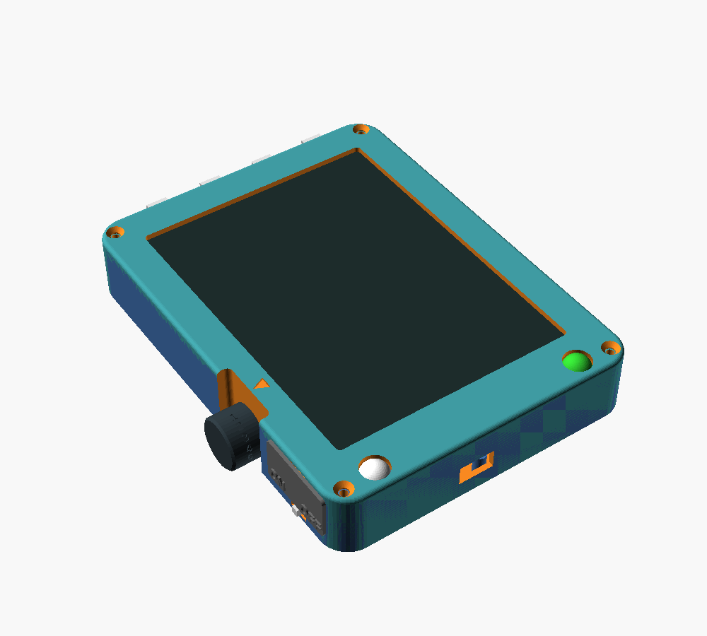 | 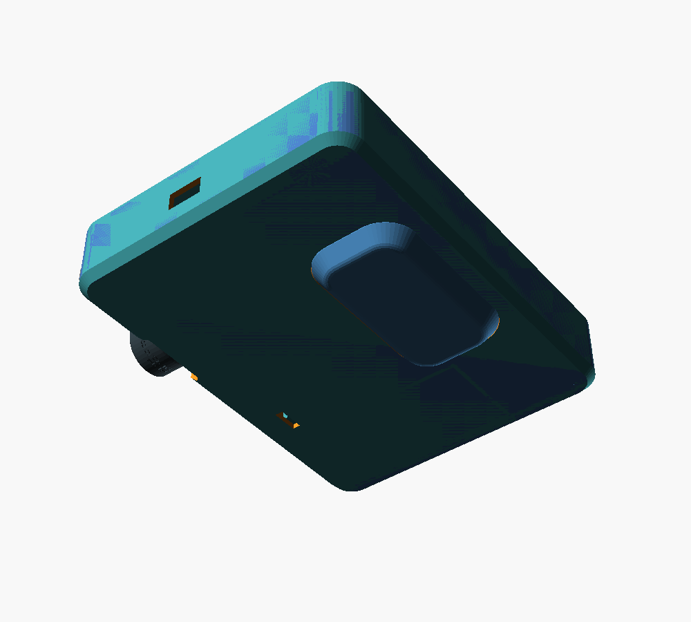 |
|:--:|:--:|
| `bump`: front, keys on the top edge, white and green spheres in the chin, story dial on the left edge | `bump`: the cap over the HAT Dupont block |

| 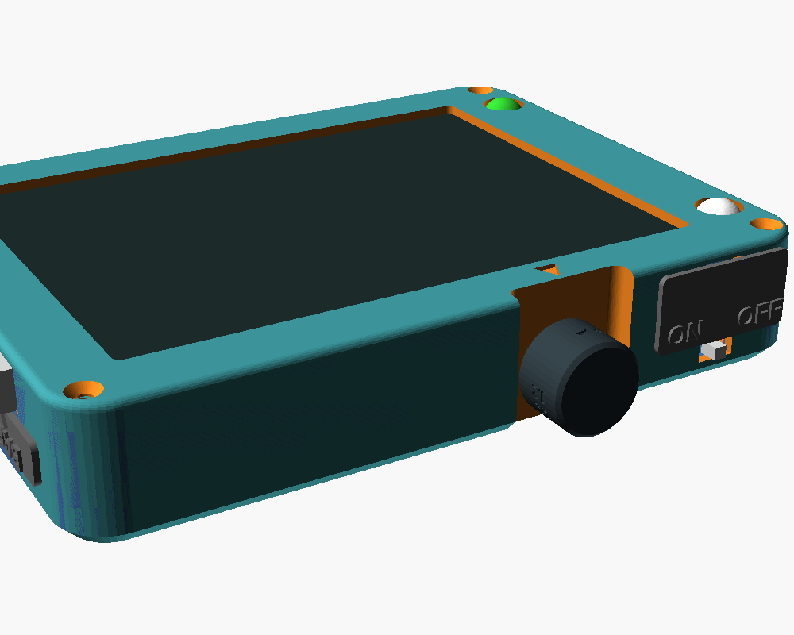 | 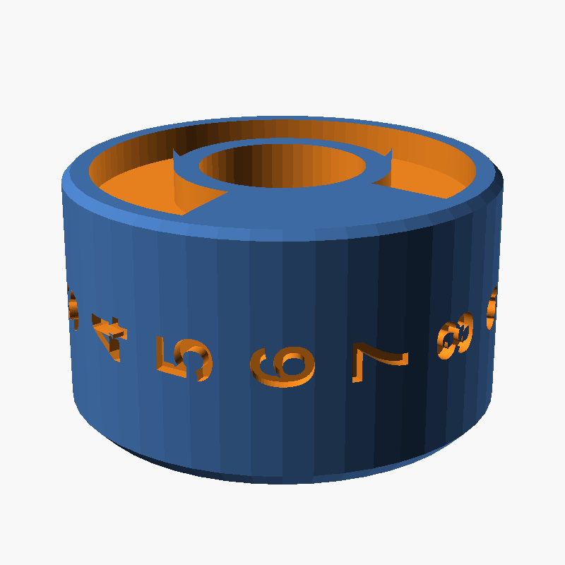 |
|:--:|:--:|
| Left edge: the thumbwheel in its notch, the ON / OFF plate under it over the switch opening | The wheel as printed, numbers engraved on the rim, nut recess and stop groove on the inner face |

| 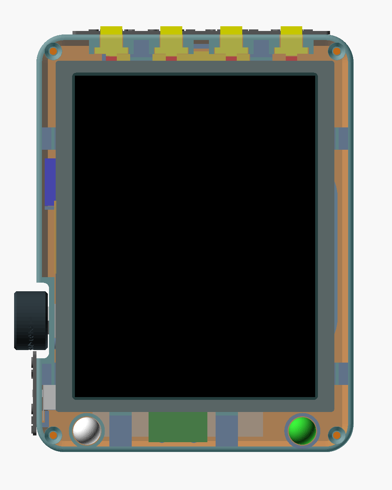 | 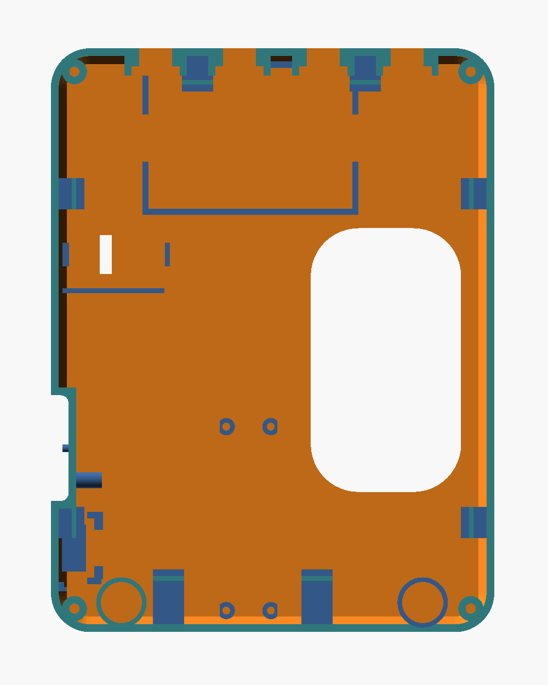 |
|:--:|:--:|
| `bump` assembly, seen from the front | `bump` back shell, display side up: hole for the cap on the right |

| 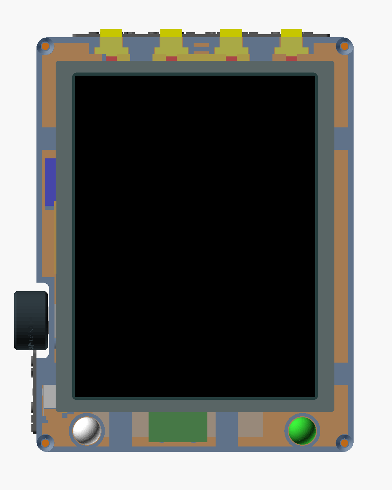 | 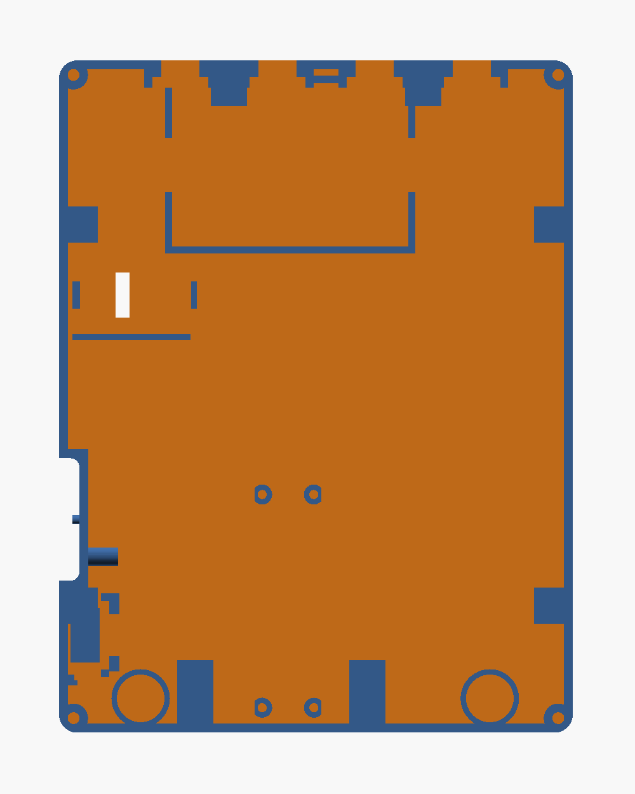 |
|:--:|:--:|
| `box` (v7) assembly | `box` (v7) back shell |

|  | 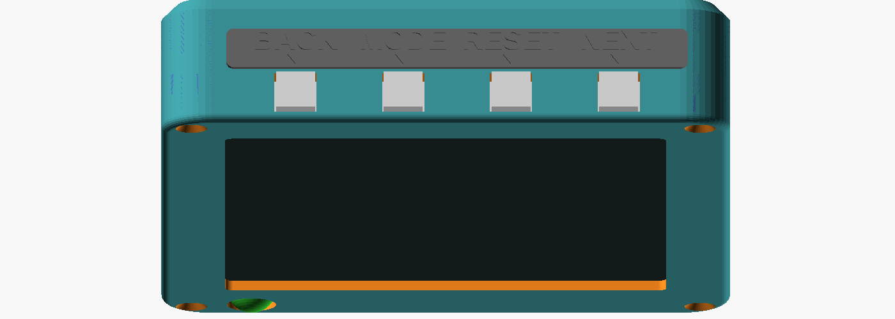 |
|:--:|:--:|
| Label plate, as printed | Top edge seen from outside, back of the case up: keys and plate |

| 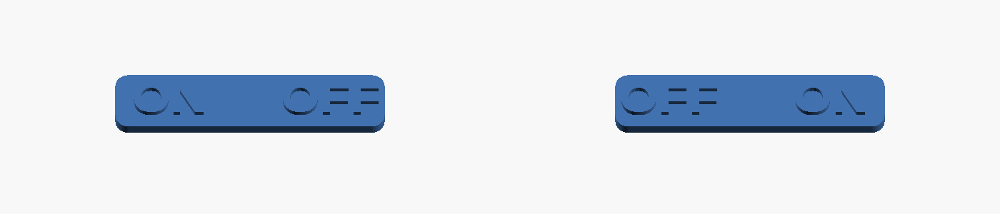 |
|:--:|
| The two ON / OFF plates for the bottom edge, on left and on right |

## Files

| File | Content |
|---|---|
| `hadistory_case.scad` | Parametric model (OpenSCAD). All dimensions are in the parameter block at the top; `style` picks `bump` or `box`. |
| `stl/bump/back.stl` | `bump` back shell, print floor down |
| `stl/bump/front.stl` | `bump` bezel, exported face up (rounded edge on top) |
| `stl/bump/cap.stl` | `bump` cap over the HAT Dupont block, exported flange down, dome up; glued inside |
| `stl/bump/key.stl` | `bump` push key, print 4 (1 mm longer than the box key: the top margin is 7 mm) |
| `stl/bump/wheel.stl`, `wheel_18.stl` | Story dial thumbwheel, print outer face down: numbers 24 degrees apart for the 30-detent KY-040 at hand (two detents per number, firmware default), or 18 degrees apart for a 20-detent encoder (`DIAL_DETENTS_PER_CYCLE` 2 in the firmware); same parts in both folders |
| `stl/bump/plate.stl` | Label plate for the keys, glued on the top edge of the case, print flat text up (same part in both folders) |
| `stl/bump/swplate_on_left.stl`, `swplate_on_right.stl` | ON / OFF plate for the switch, glued on the left edge over the switch opening, above the knob; print the one matching the wiring (same parts in both folders) |
| `stl/box/back.stl` | `box` back shell (v7 outline with the v10 insides), print floor down |
| `stl/box/front.stl` | `box` bezel, exported face down |
| `stl/box/key.stl` | `box` push key, print 4, flat on its bottom face |
| `stl/box/wheel.stl`, `wheel_18.stl` | Thumbwheels, same as above |
| `stl/box/plate.stl` | Label plate, same as above |
| `stl/box/swplate_on_left.stl`, `swplate_on_right.stl` | ON / OFF plates, same as above |

Pictures: `img/bump/`, `img/box/`, and the concepts in `img/`.

Regenerate the STL files after a change:

```bash
cd case
for p in back front cap key wheel plate; do openscad -D "part=\"$p\"" -o stl/bump/$p.stl hadistory_case.scad; done
for p in back front key wheel plate; do openscad -D 'style="box"' -D "part=\"$p\"" -o stl/box/$p.stl hadistory_case.scad; done
for d in bump box; do openscad -D 'part="wheel"' -D wheel_step=18 -o stl/$d/wheel_18.stl hadistory_case.scad; done
for d in bump box; do
  openscad -D 'part="swplate"' -D 'sw_on_left=true'  -o stl/$d/swplate_on_left.stl  hadistory_case.scad
  openscad -D 'part="swplate"' -D 'sw_on_left=false' -o stl/$d/swplate_on_right.stl hadistory_case.scad
done
```

Other values of `part`: `assembly` (shell, cap, HAT and parts preview, bezel transparent), `closed` (all parts opaque, for pictures), `section` (assembly cut at `section_x`, keeping a slab `section_w` thick, to check the clearances: 85.6 goes through the HAT header and the cap, 50 through the Pico; `section_x=2 section_w=18` keeps the left wall with the switch and the encoder, to look at from inside).

OpenSCAD on macOS: `brew install --cask openscad@snapshot` (the stable cask is disabled). The `.scad` file also opens in FreeCAD.

## How it goes together

The device is seen from the front in the model: X right, Y up, display towards the viewer. The Pimoroni drawing of the HAT is a front view with the components seen through (a mirrored version was tried in v2 and put the keys and the flex relief in the wrong place). Turned so that the buttons are on top: the 40-pin header and its Dupont block hang on the **right**, the panel flex is on the **left** edge, the four side buttons protrude from the **top** edge.

- **Depth** (`bump`): 26.6 mm in all, set by the Pico: floor 2, standoffs 8, Pico with its right-angle pins 8, then `hat_back_room` (3 mm, to measure: the clearance for the components on the back of the HAT PCB over the Pico, the header itself is elsewhere; the 4 mm module near the HAT's lower left corner, `hat_mod`, is over nothing but the switch wires), the PCB 2.8 plus the 0.8 drop, bezel 2. The Dupont housings on the HAT header, 18 mm below the PCB, end 1 mm above the floor; the cap gives them 6 mm more plus the floor thickness, for plugging. In `box`, 33 mm: the housings plus 10 mm of slack everywhere.
- **Outline** (`bump`): 10 mm plan radius, 3 mm chamfer at 45 degrees on the back edge (prints floor down as is, where a fillet would not), and a 2 mm bead at 45 degrees inside along the floor-wall junction so that 2.1 mm of material stays behind the chamfer. The corner bosses move 6 mm in from the faces (3.2 in `box`), and the top margin grows to 7 mm so that the top bosses clear the PCB corners.
- **Cap** (`bump`): a 38 x 67 mm pillow, 6 mm proud of the back, 12 mm plan radius, sides leaning in at 45 degrees and a 3 mm rounded top edge, centred on the HAT header strip (X 83 to 88, Y 45 to 96). It goes in from inside through a hole in the floor (0.2 mm clearance), its 3 mm flange sits on the inner face of the floor and is glued there before the HAT goes in; the flange also makes it captive. Walls 2 mm, the inside closes at 45 degrees so that it prints flange down without support. Its footprint stops short of the battery rib above and leaves the switch cradle clear below.
- **Back shell**: walls 2 mm, floor 2 mm. The HAT rests on eight small pads, 8 mm wide, reaching 1.6 mm under the PCB edge, 3.6 mm below the rim (`shelf_drop` 0.8 mm: 1 mm on v3 was too much, and with 0.4 the v7 glass stood 0.6 mm proud on the right side when the bezel was screwed); each pad hangs from the wall on a 45 degree gusset and carries a short locating lip outside the PCB: 0.4 mm on the long sides (`clear`, 0.8 mm on v3 left too much play), 0.1 mm on the top and bottom edges (`clear_y`: at 0.4 the v5 still had 0.6 mm of play along the PCB length). Two pads per long side, two on the bottom edge, two on the top edge between the keys, clear of the protruding caps (v4 had none on top: the PCB could ride up to the key guides, a millimetre or more off the bottom lips, and shifted at each key press). Everything else in the margins stays open: screwdriver access to the Pico, wires everywhere. Margins 4.5 mm on the sides, 6 mm on top, 12 mm chin.
- **Front**: a 2 mm plate with the window, four countersunk M3 screws into the corner bosses, and the conical hole of the sphere LED. It covers the notches of the keys and the switch opening at the rim, and holds the HAT down on its pads. In `bump` its outer edge is rounded (1.6 mm) and it prints face up, the countersinks and the LED cone being 45 degree features; `box` prints it face down.
- **Keys**: the HAT switches are on the back face of the PCB, at 19.8, 41.3, 62.7 and 84.2 mm from the flex edge (`btn_from_flex`); their caps protrude 1.5 mm from the top edge, below the PCB underside (v3 had the keys at the glass level, about 4 mm too high). Four guide blocks in the top margin, set back 2.4 mm from the PCB edge to clear the caps and hanging from the wall on a 45 degree gusset like the pads (no print support), carry a notch from 4.4 mm below the PCB underside up to the rim (`btn_cap_drop`), and a step for the 12 mm head of the key. The key is 7.6 mm tall and fills the notch, so it cannot ride up and reaches the cap wherever it sits in that range; its shaft stands 3 mm proud of the wall (`key_proud`, 1 mm on v4 was too short to find by feel). A key is dropped in from above before the HAT and is captive once the HAT and bezel are on. Its shaft and head are 0.6 mm narrower than their notch (`key_play`, 0.8 up to v6 felt loose with the 3 mm shaft outside), the head has 0.2 mm of play along the travel in its step (`key_head_play`) and the nub stops 0.3 mm short of the cap with the key fully out (`key_gap`): 0.5 mm of free travel before the click, where the v6 key had 1.1 mm. The cap protrusion (`btn_protrusion`, 1.5 mm) is still an estimate: any error on it adds to or subtracts from that free travel. The shell notches did not change: a new key fits a v6 shell.
- **Label plate**: a 92 x 8 x 1.2 mm plate glued on the outer face of the top wall, 1 mm behind the key notches, centred on the four keys. One word per key with a small pointer towards the key: left to right as seen from the front, BACK, MODE, RESET, NEXT (`plate_labels`; those are keys D, C, B, A, the firmware functions are in `pico/README.md`). Read with the display facing you and the top edge tilted towards you, or with the device lying display up and seen from beyond its top edge: the back of the case is up either way. Text and pointers stand 0.6 mm proud (`plate_relief`, a negative value engraves them instead); glue with cyanoacrylate or a dot of hot glue.
- **ON / OFF plate**: a 30 x 15.6 x 1.2 mm plate of the same construction, glued on the left wall over the switch opening, from 1 mm above the knob's travel slot up to the rim, ON on one side of the knob and OFF on the other (the words are along its lower edge, the rest of the plate hides the opening the switch went in through). Which side is on depends on how the switch was wired, so there are two variants (`sw_on_left`): `swplate_on_left.stl` and `swplate_on_right.stl`, pick the one that matches. It reads with the device face up. Glued last, after the switch check: it is what keeps the switch from riding up.
- **Switch** (v10): SS12F15 on the left wall, Y 21.5, lying on the floor with its knob through the wall, pins pointing inwards. Why not at the rim as before: the chin gave 12 mm between the wall and the HAT PCB, the side margins give 4.5, and the body is 6 mm deep, so at the rim it would sit under the PCB; 11 mm lower nothing is above it. The v9 seat (switch pushed in from inside knob first, a keeper plate behind it) did not hold it, so v10 goes back to the v7 cradle: **the switch drops in from the front**, through an opening of the wall 8 mm wide from the knob up to the rim (`sw_slot_l`), its two 0.5 mm ears sliding down between the wall and a 1.6 mm lip 0.4 mm off them at each end (`sw_lip_t`, 10 mm tall), the body on a 1.2 mm pad (`sw_pad_t`) so that the ears float. Along the wall the ears end against an end block each side, 0.2 mm of play each; in and out they are held by the lips; up, by the ON / OFF plate glued over the opening 1 mm above the knob's 3.4 mm travel slot; the bezel covers the opening at the rim. No glue on the switch, no screw; the pins and their housings are free behind the body, and the lower HAT pad moved up to Y 32 to 40 so that nothing hangs over the switch on its way in. Ear thickness and height are parameters (`sw_ear_t`, `sw_ear_h`), to check on the part.
- **Story dial** (v10): a KY-040 module standing behind the left wall, encoder towards the wall, PCB along the wall (26.1 x 18.6 mm, `enc_pcb_l`, `enc_pcb_w`) from Y 45.5 to 71.6, axis at Y 54.6. Where exactly is set by the HAT: a 26 x 10 mm module with a connector stands 4 mm proud of its back near the lower left corner (`hat_mod`: X 10.9 to 20.9, Y 18.4 to 44.4, drawn in the previews), more than the 3 mm of `hat_back_room`, so the encoder PCB, 1.2 mm under the HAT, starts 1.1 mm above it; and its five Dupont housings must not run under it either, so the module's right-angle header is at the **upper** end, pins towards the top edge (`enc_pins_up`), the housings lying along the floor from Y 71.6 on. The module's two mounting holes are both along one long edge (7.8 mm from the axis, 5.5 and 8.5 mm either side of it along the board, `enc_hole_dw`, `enc_hole_dl`; v9 had them across the board, hence a print with the holes off the posts), and with the pins up that edge is the HAT side: the holes sit 2.6 mm under the PCB's top edge (`enc_hole_edge`, to measure), the axis 7.8 lower, 9.4 mm above the back face, and the wheel is 18.4 mm, bottom 0.2 mm above the back (pins down would give 11.6 and 21 mm, as in the first v10 draft). The left edge gets a notch, 4.5 mm deep and 24.4 mm long (Y 42.4 to 66.8, 2 mm corner radius), through the shell and the bezel; the 2 mm wall behind it ends at X 6.5, just outside the HAT PCB, and carries a 1.6 mm stop pin outside; where it runs into the span of the panel flex (from Y 63.8) it is thinned to 1.2 mm above Z 16, leaving the fold 1.2 mm beyond the PCB edge. The encoder's bushing is 12 mm long (`enc_bush_h`, v9 assumed 7 and the wheel could not reach its stop) and the body 4 mm (`enc_body_h`): a 12 mm wide boss rises from the floor behind the notch wall and takes the length the wall and the nut do not, 6.6 mm, the body sits on its face and the bushing hole runs through wall and boss as a teardrop (it prints lying); outside, 3.4 mm of bushing for the nut and a millimetre of thread (`enc_bush_out`). One 5 mm rib from the floor, from X 7.5 (clear of the flex fold) to the PCB under the hole beyond the body (8.5 mm from the axis), takes an M3 screw from behind; the other hole, 5.5 mm from the axis, is level with the body and gets no rib, the nut holds the rest. The PCB stands in a 0.8 mm recess of the floor (`enc_floor_recess`), 1.2 mm under the HAT. The thumbwheel is 12 mm thick: 4 mm inside the notch, hiding the nut (round recess, the wheel turns around it) and the bushing end, 8 mm proud of the edge. Its shaft bore is a blind D, 6.1 mm with the flat 1.7 mm from the axis (4.75 across), the shape of the knob cap printed earlier for this encoder, so the wheel presses on without glue; the 12 mm shaft is **cut to 7.8 mm beyond the bushing end** (4.2 mm off, echoed by the model). The D fixes the wheel's angle on the shaft, and the detents are fixed on the shaft too, so where the 1 lands at the lower stop is a property of the encoder: `wheel_phase` turns the numbers and the groove about the flat, to be set from the first print (angle between the 1 and the arrow at the stop detent, 18 degrees per detent). Numbers 1 to 12 are engraved on the rim every `wheel_step` degrees, one firmware step apart, upright for the reader, 1 on top at the lower stop; an arrow 5 x 4.8 mm engraved 0.8 mm into the bezel margin (`arrow_*`) points at the number in use. On the inner face of the wheel, a 1.6 mm deep arc groove, 2.4 mm wide at radius 7.6, takes the stop pin: 11 steps of travel plus the pin, its ends are the stops; on the 18.4 mm wheel it opens into the nut recess on the inside and leaves 0.4 mm of rim outside, so that face has no chamfer (it sits in the notch). `wheel_step` depends on the encoder. The KY-040 at hand has 30 detents a turn and gives half a quadrature cycle per detent, so the firmware's default count (one step per full cycle) moves one number every two detents: 24 degrees per number, 264 degrees of travel, three quarters of the wheel (`wheel.stl`). On a 20-detent encoder two detents per number would need 396 degrees, so the firmware would be built with `DIAL_DETENTS_PER_CYCLE` 2 (a step at every detent) and the wheel printed at 18 degrees (198 degrees of travel, `wheel_18.stl`). Count the detents on one turn of the bare encoder to know which. The firmware saturates its count at both ends, see `pico/README.md`.
- **Panel flex**: on the left edge, between the two left pads; nothing touches the PCB edge there.
- Outer size 113 x 148 x 33 mm.

## Electronics inside the back shell

| Part | Where | Fixing |
|---|---|---|
| Pico 2 W, right-angle headers on both long sides | Lower middle left, standing, USB towards the bottom wall through a 13 x 7 mm opening; 20 mm kept free on each side for the Dupont housings | 4 M2 screws on 8 mm standoffs of 4.4 mm (2 mm pilot holes), each with a flat on its outer face 1.6 mm from the hole over the top 3.2 mm, where the header plastic sits next to the holes (`pico_post_flat`, `pico_post_relief_h`); nothing above the screws |
| TP4056 (IN+ IN- B+ B-), its micro-USB unused | Against the left wall under the battery, B+/B- end 1 mm from the wall, USB end towards the Pico (`tp_usb_out`; false puts the USB at the wall, everything about the module mirrors) | No mounting holes on the module and its LEDs sit 15 mm in from the USB edge, so it is glued components DOWN: the micro-USB shell rests on the floor at the Pico end, a 1.6 x 6 mm rib at the wall carries the B+/B- edge between its pads (`tp_usb_h`, 3.2 mm, to check), wires soldered on the bare side. A 1.2 mm lip along its lower long edge and an end stop past the USB end, with the left wall and the battery rib, set where it goes (`tp_clear`); a 3 x 10 mm window through the floor under the charge / full LEDs, 11 mm from the wall (`tp_led_x` from the USB edge, `tp_win`), shows them from the back |
| KY-040 rotary encoder module (story dial) | Behind the left wall, PCB along it from Y 45.5 to 71.6 (above the HAT's back module), right-angle header at the top end: the five pins leave towards the top edge, holes along the HAT-side edge | Its M7 bushing through the notch wall and the boss behind it, nut in the notch; one M3 self-tapping screw from behind the PCB into a 5 mm rib on the floor under the hole beyond the body (`enc_hole_dw`, `enc_hole_dl`, `enc_hole_edge`); the PCB stands in a 0.8 mm recess of the floor (`enc_floor_recess`); five Dupont wires on its header, along the floor up the wall then across to the Pico |
| 103450 LiPo 2000 mAh | Across the top of the shell | Ribs with 1 mm clearance, 12 mm openings at both ends for the wires |
| SS12F15 slide switch | Left wall, Y 21.5, lying on the floor, knob through the wall | Dropped in from the front through the wall opening, ears sliding behind the two lips, between the lower end block and the notch wall, body on a pad; the ON / OFF plate glued over the opening keeps it down; no screws, no glue on the switch (`sw_y`, `sw_lip_*`) |
| dLUX-dLITE sphere LEDs (Adafruit 5431) + 220 ohm, white = status at X 18, green = AI mode at X 95 | Chin, both ends | Tubes in the shell (1.2 mm wall, 0.4 mm clear of the PCB edge: the 1.6 mm tube of v4 overlapped it), open towards the inside for the wires up to 8 mm above the floor, the opening closing with a 45 degree roof so that it prints without support, conical hole in the bezel |

Power wiring (the HAT's 5V pin is not needed: on this HAT it only feeds the small expansion header, the panel runs from 3V3; the whole wiring is drawn in `pico/img/wiring.png`):

| From | To |
|---|---|
| Battery + / - | TP4056 B+ / B- |
| Pico VBUS (pin 40) | TP4056 IN+ : the Pico's USB charges the battery |
| TP4056 IN- / B- | Pico GND |
| TP4056 B+ | Slide switch, centre pin |
| Slide switch, side pin | Anode of a 1 A Schottky diode (1N5817, 1N5819, SS14; a 1N4007 also works with a larger drop). Not a 1N5711, it is a 15 mA signal diode. |
| Diode cathode | Pico VSYS (pin 39) |

The diode keeps the USB 5V from reaching the battery through the Pico when the USB is plugged with the switch on. A TP4056 module without B+/B- protection relies on the protection circuit of the cell itself (most 103450 pouch cells have one).

Signal wiring: see the wiring tables in `pico/README.md` (display on GP17 to GP22, buttons on GP2 to GP5, LED on GP8), with the HAT's 3V3 and GND.

## Printing

PLA or PETG, 0.4 mm nozzle, 0.2 mm layers, 3 walls, no supports: every overhang in the shell (pads, key guides, switch pad) sits on a 45 degree gusset, the back chamfer and the inner bead are at 45 degrees, the cap prints flange down with its dome narrowing upwards and a 45 degree ceiling inside, the `bump` bezel prints face up. The back shell always prints floor down; a rounded back would have needed supports or the shell printed rim down, which would have left the Pico standoffs and the ribs in the air, hence the chamfer and the separate cap. The model keeps heights on multiples of 0.2 mm and thin features on multiples of 0.4 mm: when adjusting a parameter, move by at least one layer (0.2 mm) or one line (0.4 mm), smaller changes are not reproduced. Printed holes come out smaller than modelled: the M3 pilot holes are 2.6 mm, the Pico M2 holes 2.0 mm.

Label plates (keys and ON / OFF): flat, text up, 0.2 mm layers (0.1 mm looks better on the letters). The strokes of the 4 mm words are about 0.6 mm wide, so enable the slicer's thin wall / gap fill option (PrusaSlicer "Detect thin walls", Cura "Print thin walls"), or print at 0.4 mm line width with a single perimeter for the top 0.6 mm. For two colours, change the filament at 1.2 mm, where the text starts; or set `plate_relief` to -0.6 and fill the engraved letters with paint.

## Print checklist

Version 10 (encoder seat and switch seat redone after the v9 print: the module's holes were across the posts, its 12 mm bushing left the wheel short of its stop, and the switch did not hold; v9 brought the story dial and the switch to the left edge and the green sphere to the right of the chin, on top of v8: `bump` outline, depth and cap, TP4056 glued components down with an LED window in the floor; same insides in both styles) after test prints of versions 1 to 6 of the box (v4: keys, LED, switch and Pico all good, the HAT had play towards the chin; v5: 0.6 mm of play left along the PCB length, keys too short to find by feel; v6: label plate, keys loose with 1.1 mm of free travel, switch rocking in its grooves; v7: glass and switch 0.6 mm proud on the right side when screwing the bezel, hence `shelf_drop` 0.8 and `sw_drop` 0.4). To check with the parts placed, before wiring:

1. HAT: drops onto the eight pads with little play (`clear`) in both directions, glass 0.8 mm below the rim (`shelf_drop`), buttons free above the top margin, flex free on the left edge.
2. Keys: centred on the button caps in X and covering them in depth (`btn_from_flex`, `btn_cap_drop`), slide in their notches, heads seated in the step, about 0.5 mm of free travel before the click (`key_gap`, `key_head_play`; more means `btn_protrusion` is overestimated, to measure on the HAT).
3. Pico: screwed on its standoffs, housings on the pins clear of the floor, USB centred in its opening (`pico_standoff`, `pico_pos()`).
4. Dupont housings on the HAT header: nothing touches the floor with the HAT in place (`dupont_slack`).
5. Switch: dropped in from the front through the wall opening, ears sliding behind the two lips down to the pad (`sw_ear_len`, `sw_ear_t`, `sw_ear_h`), ends between the lower block and the notch wall with little play; the knob slides in the lowest 3.4 mm of the opening and the switch does not rock or back off when the knob is pushed in; the ON / OFF plate, held over the opening, leaves the knob free and stops it from lifting; glue the plate only after this check.
6. Screws: M3 bite in the bosses without splitting them.
7. TP4056: components down, B+/B- edge at the wall, it sits level on its USB shell and the wall-side rib (`tp_usb_h`), between the lip, the end stop, the left wall and the battery rib (`tp_l`, `tp_w`, `tp_clear`); its LEDs show through the floor window from the back (`tp_led_x`, `tp_win`); glue it only after this check, with the wires already soldered on the bare side.
8. Story dial: the encoder has 30 detents a turn (counted), `wheel.stl` is numbered every two detents; the KY-040 PCB stands in its floor recess, pins towards the top edge, 1 mm above the HAT's back module (`hat_mod`), the bushing through the wall and the boss with the body flat on the boss face, its upper hole on the rib (`enc_hole_dl`, `enc_hole_dw`, `enc_hole_edge`, `enc_cx`: measure them on the module), screwed from behind, the nut tightened in the notch with the bushing end 3.4 mm out of the wall (`enc_bush_h`, `enc_bush_out`, `enc_body_h`); the PCB must not touch the HAT; the housings on the header lie along the floor above Y 71 and clear the panel flex fold at the PCB edge; shaft cut to the echoed length (7.8 mm beyond the bushing end); the wheel pressed on its D turns freely in the notch and reaches the stop pin, its groove over the pin, 11 detents between the stops; at the lower stop the 1 is under the arrow, else measure the offset, set `wheel_phase`, reprint the wheel.
9. `bump` only: the HAT underside clears the Pico (`hat_back_room`, 3 mm nominal, measure the tallest component on the back of the HAT over the Pico area); the cap slides into its hole from inside and its flange sits flat on the floor; the Dupont housings on the HAT header stay clear of the cap ceiling.

## Design directions

`concepts.scad` holds the visual-only concepts drawn before v8 on the real envelope, `concept = "grip" | "bump" | "slim"`, `view = "front" | "back"`. The thickness was the question: the Dupont housings plugged on the HAT header need 33 mm over a 5 x 51 mm strip on the right of the device, everything else fits in about 26 mm. **`bump` was chosen (2026-10-20) and is now the functional model above.** The other two stay for reference:

| 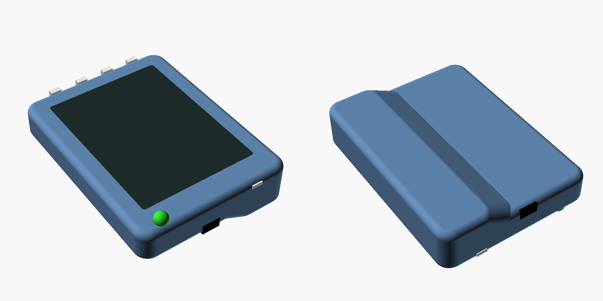 |
|:--:|
| `grip`: thin body, vertical band on the right over the Dupont block, e-reader style. |

| 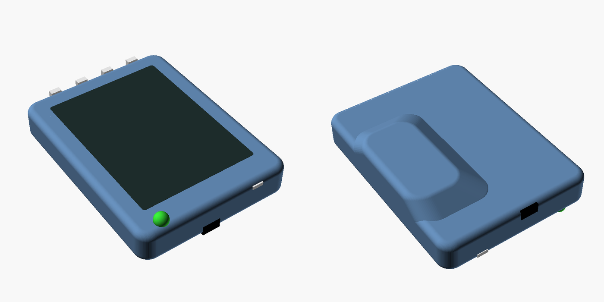 |
|:--:|
| `bump`: thin body, rounded bump on the back over the Dupont block only. In the functional model the bump is a separate cap, since a bump printed with the shell would need supports. |

| 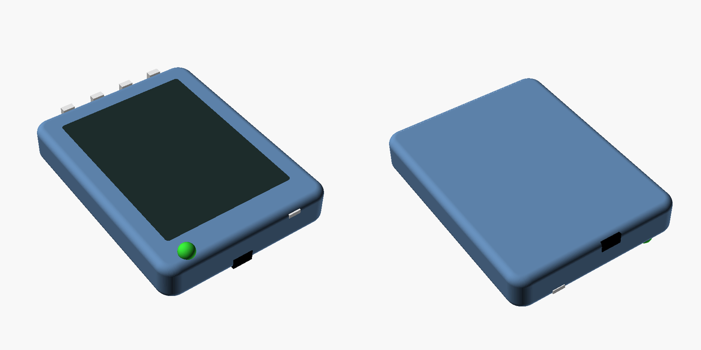 |
|:--:|
| `slim`: thin all over, needs the HAT wired flat: a 2x20 right-angle male header plugged into the HAT's female header lays the Dupont housings flat (about 14 mm instead of 18), wires soldered on a straight header give about 11.5 mm. Still an option to shrink the cap later. |

Mode indication (decided 2026-10-21): the firmware draws a robot pictogram in the top-left corner of every AI page, where the story mode draws its page counter, so that the panel itself tells the mode, even asleep or off (`img/robot_badge.png`); the status LED keeps the mode bursts of the Pi version. A second LED for the AI mode was tried beside the white sphere and dropped: `img/led_options.png` compares the placements (A: 10 mm green sphere beside the white one, B: 5 mm green LED beside it, C: green sphere at the right end of the chin with the switch moved, D: badge only). A 5 mm LED at X 31 fits, but a second dLUX sphere there needs a 12.9 mm tube that reaches Y 14 in the chin and blocks the Dupont housing on Pico pin 4 (button A); option C has no room unless the switch moves into the corner boss. Only a 5 mm LED, or moving the four button wires two pins up the Pico (GP4 to GP7), would bring it back.

**v9 (2026-10-23)**: story dial on the left edge and the second sphere back. Drawn first as a concept, `concept_v9.scad`, visual only on the v8 bump body, then built into the functional model above. The concept pictures:

| 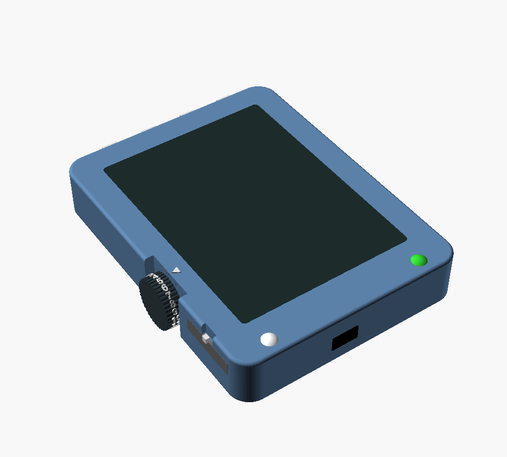 | 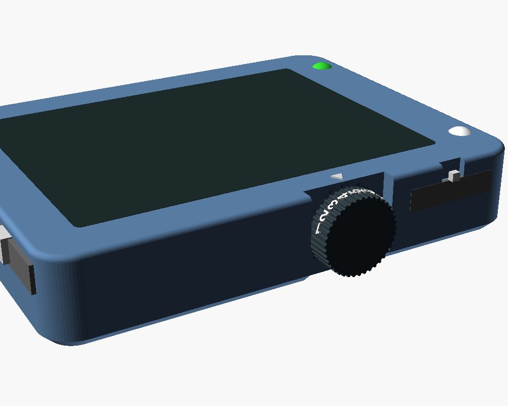 | 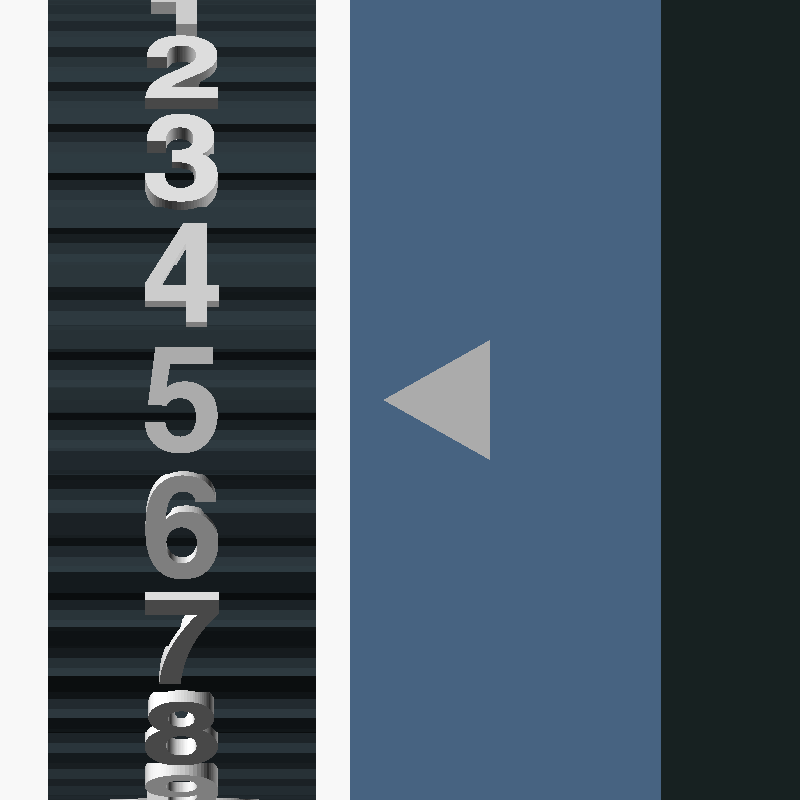 |
|:--:|:--:|:--:|
| Two spheres in the chin: white status left, green AI mode right, the switch gone from the bottom edge | Left edge: thumbwheel in a notch, ON / OFF switch under it | The number in use faces the viewer, under an arrow on the bezel margin |

- **Story dial**: a KY-040 encoder standing behind the left wall, its threaded bushing through the wall. Outside, a thumbwheel half sunk in a notch of the edge, the numbers 1 to 12 upright on its rim one firmware step apart (24 degrees: two detents of the 30-detent encoder), an arrow on the bezel pointing at the one in use. A pin in an arc groove limits the travel to 11 detents: the end stops are the absolute reference of an otherwise incremental encoder, the firmware saturates its index at 1 and 12. In the functional model the wheel ended up 21 x 12 mm (the encoder PCB sets the axis height, the bushing and nut need the thickness), at Y 47 to stay clear of the HAT pad below and the panel flex above. Selection is blind by design (no scrolling on a 30 s panel) and nothing counts during the deep sleep, so the ritual is: wheel down to the stop, press the wheel (RESET, re-arms the count at 1), turn up to the number, GO.
- **Switch** moved to the left edge under the wheel, with its ON / OFF plate; the bottom edge keeps only the Pico USB. In the functional model it lies on the floor: at the rim, as before, its 6 mm body would have met the HAT PCB, the left margin being 4.5 mm where the chin was 12.
- **Second sphere** at the right end of the chin (X 95), where the switch was: no conflict with the Dupont housings, no button wire moves. White = activity, green = AI mode.
- Firmware side: done behind the `STORY_DIAL` build option (`pico/README.md`), deep sleep kept as it is: the wheel is counted awake only, hence the re-arm by RESET. Counting asleep (dormant mode) stays a possible later step.

**v10 (2026-10-23)**, from the first v9 print: the KY-040 was modelled from a guess, the print showed its holes are both along one long edge of the board (the datasheet picture and the user's own face plate agree: 7.8 mm from the axis, 5.5 and 8.5 mm along the board), its bushing is 12 mm long, not 7, and its header is a right-angle one. So the module turned a quarter turn, the posts became ribs on the floor, a boss behind the notch wall takes the extra bushing length. Then the HAT turned out to carry a 4 mm module on its back near the lower left corner, right where the encoder stood: the dial moved up to Y 54.6, pins towards the top edge so that the housings stay clear of it, which puts the holes on the HAT side and the axis at 9.4 mm, wheel 18.4 mm. The switch seat went back to the v7 idea, a cradle the switch drops into from the front, with the wall opened up to the rim and the ON / OFF plate covering the opening.

```bash
openscad -o img/concept_v9_front.png --imgsize=1000,900 --camera=-123,-186,316,56.65,74.6,13 --viewall --projection=p --colorscheme=Tomorrow concept_v9.scad
openscad -o img/concept_v9_left.png  --imgsize=1000,800 --camera=30,74,13,65,0,240,300 --projection=p --colorscheme=Tomorrow concept_v9.scad
openscad -o img/concept_v9_wheel.png --imgsize=800,800 --camera=6,60,13,0,0,0,60 --projection=o --colorscheme=Tomorrow concept_v9.scad
```

Render a concept (front and back views, same camera, the back view turns the model over; combined with ImageMagick):

```bash
openscad -D 'concept="grip"' -D 'view="front"' -o grip_front.png --imgsize=900,900 --camera=-123,-186,316,56.65,74.1,16.5 --viewall --projection=p --colorscheme=Tomorrow concepts.scad
openscad -D 'concept="grip"' -D 'view="back"'  -o grip_back.png  --imgsize=900,900 --camera=-123,-186,316,56.65,74.1,16.5 --viewall --projection=p --colorscheme=Tomorrow concepts.scad
magick grip_front.png grip_back.png +append -resize 1400x img/concept_grip.png
```

Pictures of the functional model:

```bash
openscad -o img/bump/assembly.png --imgsize=1000,1250 --camera=57,74,0,0,0,0,440 --projection=o --colorscheme=Tomorrow hadistory_case.scad
openscad -D 'part="back"' -o img/bump/back.png --imgsize=1000,1250 --camera=57,74,0,0,0,0,440 --projection=o --colorscheme=Tomorrow hadistory_case.scad
openscad -D 'part="closed"' -o img/bump/front.png --imgsize=1000,900 --camera=-123,-186,316,56.65,74.6,13 --viewall --projection=p --colorscheme=Tomorrow hadistory_case.scad
openscad -D 'part="closed"' -o img/bump/rear.png  --imgsize=1000,900 --camera=257,-186,-284,56.65,74.6,13 --viewall --projection=p --colorscheme=Tomorrow hadistory_case.scad
openscad -D 'part="closed"' -o img/bump/left.png  --imgsize=1000,800 --camera=30,74,13,65,0,240,300 --projection=p --colorscheme=Tomorrow hadistory_case.scad
openscad -D 'part="wheel"'  -o img/bump/wheel.png --imgsize=800,800 --camera=0,0,6,70,0,30,70 --projection=p --colorscheme=Tomorrow hadistory_case.scad
openscad -D 'part="section"' -o section.png --imgsize=1400,420 --camera=85.6,74.6,13,90,0,270,170 --projection=o --colorscheme=Tomorrow hadistory_case.scad
```
