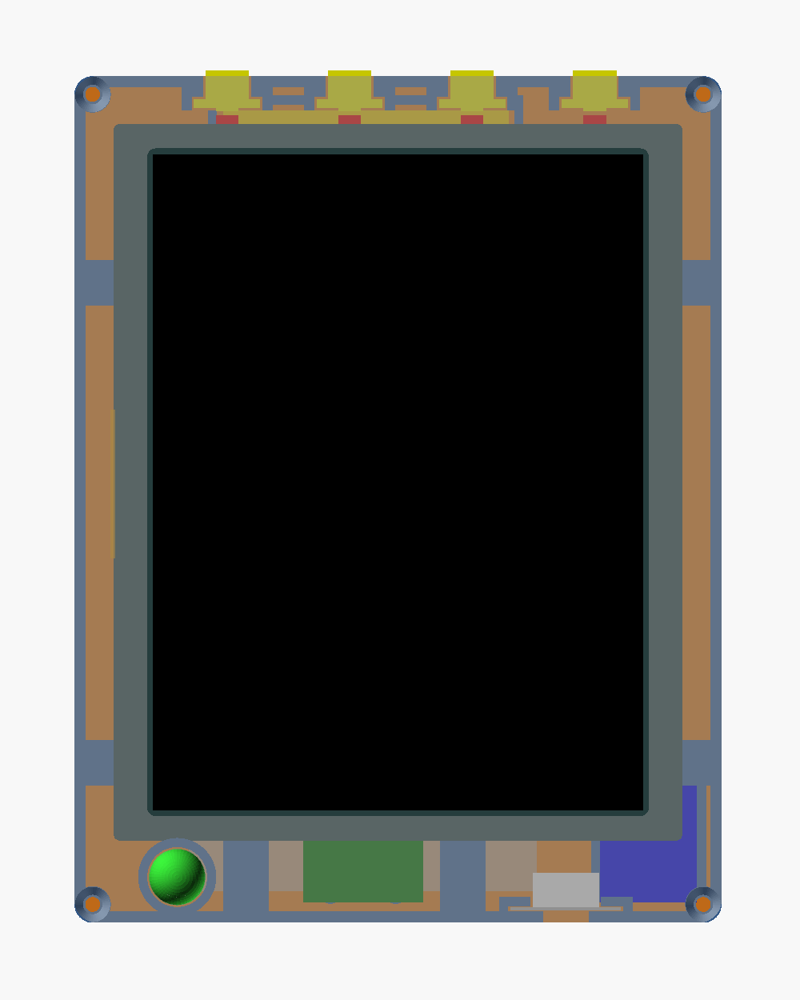
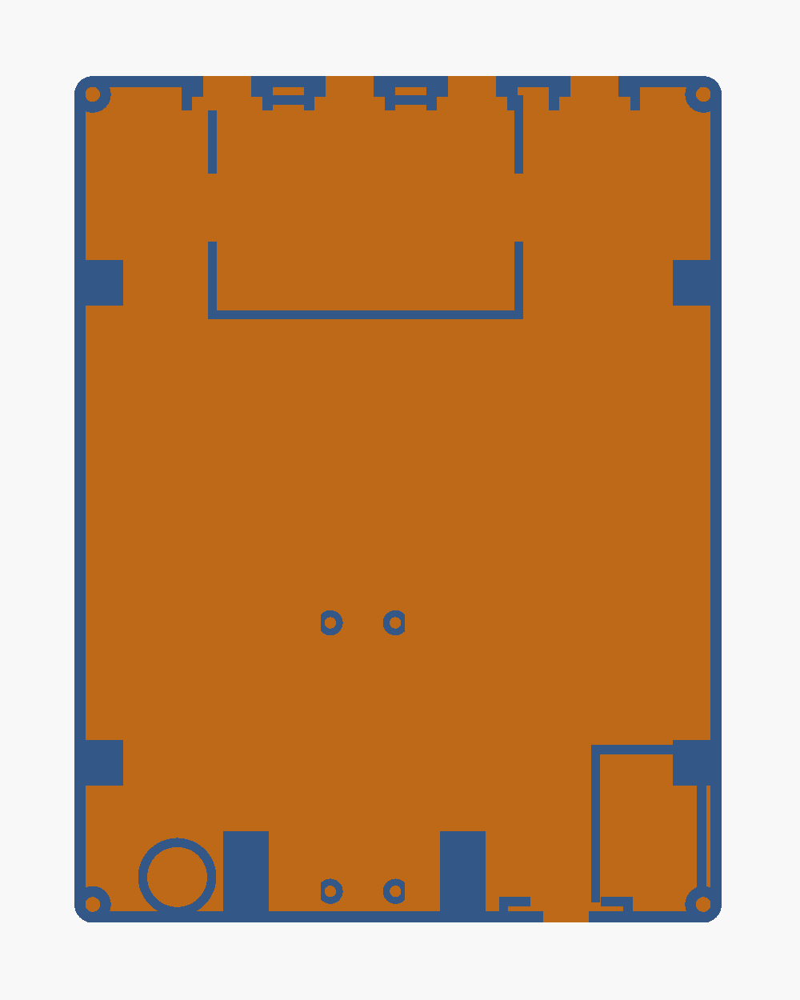

# hadistory — enclosure for the Pico version

A two-part 3D printed case, portrait, with the Inky Impression 5.7" as the face and the electronics in the back shell. Design inspired by the [YouMakeTech Pico-GB](https://www.youmaketech.com/pico-gb-gameboy-emulator-handheld-for-raspberry-pi-pico/) bottom cover: every part sits in a moulded pocket or on standoffs, and all the wiring is Dupont jumpers.

|  |  |
|:--:|:--:|
| Assembly, seen from the front | Back shell, display side up |

## Files

| File | Content |
|---|---|
| `hadistory_case.scad` | Parametric model (OpenSCAD). All dimensions are in the parameter block at the top. |
| `stl/hadistory_back.stl` | Back shell, print floor down |
| `stl/hadistory_front.stl` | Bezel plate, exported face down ready to print |
| `stl/hadistory_key.stl` | Push key for the HAT side buttons, print 4, flat on its bottom face |

Regenerate the STL files after a change:

```bash
cd case
openscad -D 'part="back"'  -o stl/hadistory_back.stl  hadistory_case.scad
openscad -D 'part="front"' -o stl/hadistory_front.stl hadistory_case.scad
openscad -D 'part="key"'   -o stl/hadistory_key.stl   hadistory_case.scad
```

OpenSCAD on macOS: `brew install --cask openscad@snapshot` (the stable cask is disabled). The `.scad` file also opens in FreeCAD.

## How it goes together

The device is seen from the front in the model: X right, Y up, display towards the viewer. The Pimoroni drawing of the HAT is a front view with the components seen through (a mirrored version was tried in v2 and put the keys and the flex relief in the wrong place). Turned so that the buttons are on top: the 40-pin header and its Dupont block hang on the **right**, the panel flex is on the **left** edge, the four side buttons protrude from the **top** edge.

- **Back shell**: walls 2 mm, floor 2 mm, 29 mm deep inside (Dupont housings on the HAT header, 18 mm, plus 10 mm to handle them). The HAT rests on six small pads, 8 mm wide, reaching 1.6 mm under the PCB edge, 3.2 mm below the rim (`shelf_drop` 0.4 mm: 1 mm on v3 was too much); each pad hangs from the wall on a 45 degree gusset and carries a short locating lip 0.4 mm outside the PCB (`clear`, 0.8 mm on v3 left too much play). Two pads per long side, two on the bottom edge, none on the top edge where the buttons protrude. Everything else in the margins stays open: screwdriver access to the Pico, wires everywhere. Margins 4.5 mm on the sides, 6 mm on top, 12 mm chin.
- **Front**: a flat 2 mm plate with the window, four countersunk M3 screws into the corner bosses, and the conical hole of the sphere LED. It covers the notches of the keys and of the switch knob at the rim, and holds the HAT down on its pads.
- **Keys**: the HAT switches are on the back face of the PCB, at 19.8, 41.3, 62.7 and 84.2 mm from the flex edge (`btn_from_flex`); their caps protrude 1.5 mm from the top edge, below the PCB underside (v3 had the keys at the glass level, about 4 mm too high). Four guide blocks in the top margin, set back 2.4 mm from the PCB edge to clear the caps, carry a notch from 4.4 mm below the PCB underside up to the rim (`btn_cap_drop`), and a step for the 12 mm head of the key. The key is 7.2 mm tall and fills the notch, so it cannot ride up and reaches the cap wherever it sits in that range. A key is dropped in from above before the HAT and is captive once the HAT and bezel are on; its nub stops 0.3 mm short of the cap (`btn_protrusion`, to measure).
- **Switch**: SS12F15 standing against the bottom wall at the rim, knob through a notch in the wall, pins pointing inwards. Its two mounting ears slide down into two grooves between the wall and a small rib on each side; the grooves locate it and the bezel holds it down. No screws; placed from above before closing. Ear thickness and height are parameters (`sw_ear_t`, `sw_ear_h`), to check on the part.
- **Panel flex**: on the left edge, between the two left pads; nothing touches the PCB edge there.
- Outer size 113 x 148 x 33 mm.

## Electronics inside the back shell

| Part | Where | Fixing |
|---|---|---|
| Pico 2 W, right-angle headers on both long sides | Lower middle left, standing, USB towards the bottom wall through a 13 x 7 mm opening; 20 mm kept free on each side for the Dupont housings | 4 M2 screws on 8 mm standoffs of 4.4 mm (2 mm pilot holes), each with a flat on its outer face 1.6 mm from the hole over the top 3.2 mm, where the header plastic sits next to the holes (`pico_post_flat`, `pico_post_relief_h`); nothing above the screws |
| TP4056 (IN+ IN- B+ B-), its micro-USB unused | Bottom right | Ribs on three sides |
| 103450 LiPo 2000 mAh | Across the top of the shell | Ribs with 1 mm clearance, 12 mm openings at both ends for the wires |
| SS12F15 slide switch | Bottom wall, right of the Pico USB, at the rim | Ears in two grooves, no screws |
| dLUX-dLITE sphere LED (Adafruit 5431) + 330 to 470 ohm | Chin, bottom left | Tube in the shell, open towards the inside for the wires, conical hole in the bezel |

Power wiring (the HAT's 5V pin is not needed: on this HAT it only feeds the small expansion header, the panel runs from 3V3):

| From | To |
|---|---|
| Battery + / - | TP4056 B+ / B- |
| Pico VBUS (pin 40) | TP4056 IN+ : the Pico's USB charges the battery |
| TP4056 IN- / B- | Pico GND |
| TP4056 B+ | Slide switch, centre pin |
| Slide switch, side pin | Anode of a 1 A Schottky diode (1N5817, 1N5819, SS14; a 1N4007 also works with a larger drop). Not a 1N5711, it is a 15 mA signal diode. |
| Diode cathode | Pico VSYS (pin 39) |

The diode keeps the USB 5V from reaching the battery through the Pico when the USB is plugged with the switch on. A TP4056 module without B+/B- protection relies on the protection circuit of the cell itself (most 103450 pouch cells have one).

Signal wiring: see the wiring tables in `pico/README.md` (display on GP17 to GP22, buttons on GP2 to GP5, LED on GP8), with the HAT's 3V3 and GND.

## Printing

PLA or PETG, 0.4 mm nozzle, 0.2 mm layers, 3 walls, no supports. The model keeps heights on multiples of 0.2 mm and thin features on multiples of 0.4 mm: when adjusting a parameter, move by at least one layer (0.2 mm) or one line (0.4 mm), smaller changes are not reproduced. Printed holes come out smaller than modelled: the M3 pilot holes are 2.6 mm, the Pico M2 holes 2.0 mm.

## Print checklist

Version 4, after test prints of versions 1 to 3. To check with the parts placed, before wiring:

1. HAT: drops onto the six pads with little play (`clear`), glass 0.4 mm below the rim (`shelf_drop`), buttons free above the top margin, flex free on the left edge.
2. Keys: centred on the button caps in X and covering them in depth (`btn_from_flex`, `btn_cap_drop`), slide in their notches, heads seated in the step, 0.2 to 0.5 mm from the caps (`btn_protrusion`, to measure on the HAT).
3. Pico: screwed on its standoffs, housings on the pins clear of the floor, USB centred in its opening (`pico_standoff`, `pico_pos()`).
4. Dupont housings on the HAT header: nothing touches the floor with the HAT in place (`dupont_slack`).
5. Switch: body in its pocket, knob sliding in the notch, bezel closes over it.
6. Screws: M3 bite in the bosses without splitting them.
